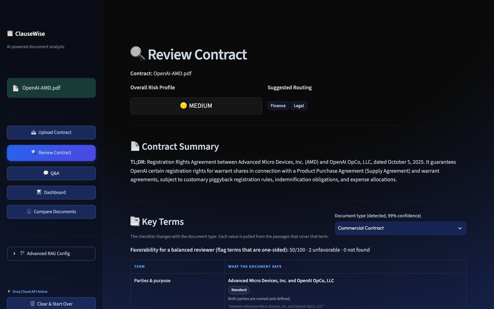
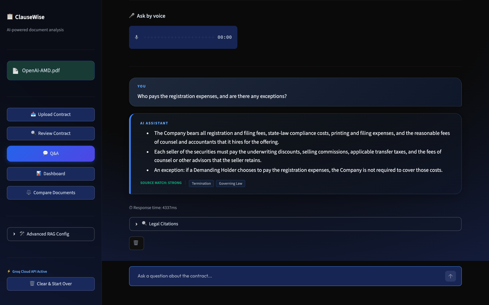
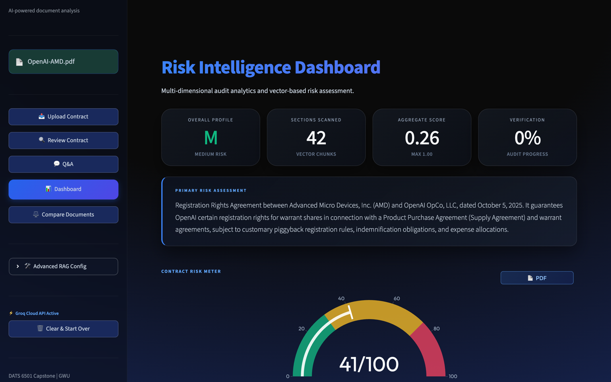
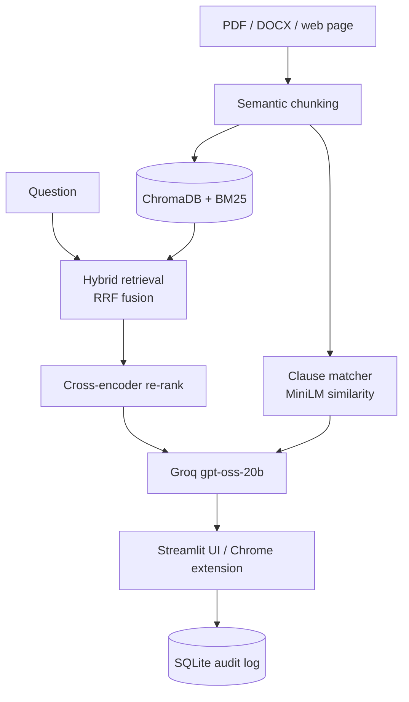

# ClauseWise

**Upload a contract, get a risk review, and ask it questions in plain English.**
A retrieval-augmented (RAG) contract analysis app, evaluated on the CUAD legal benchmark.

[**▶ Try the live demo**](https://clausewise-rasika.streamlit.app) · [Evaluation results](evaluation/EVALUATION_RESULTS.md) · [Architecture](docs/ARCHITECTURE.md)

[](https://github.com/Rasika1200/ClauseWise/actions/workflows/tests.yml)


> The demo runs on Streamlit Community Cloud's free tier. If it has been idle it shows a "wake up" screen; click it and give it a minute.
> Click **✨ Load Demo Contract** to explore a real AMD–OpenAI agreement without uploading anything.



**Stack:** Python · Streamlit · Groq (`gpt-oss-20b`, Whisper) · ChromaDB · BM25 · sentence-transformers (MiniLM, cross-encoder) · FastAPI · SQLite · Plotly

---

## What it does

- **Contract review.** Extracts the key clauses with verbatim quotes, rates each one's risk, writes a plain-English summary and suggests which team should review it (Legal, Finance…).
- **Key-terms checklist by document type.** Detects the type (NDA, employment, lease, loan, credit card or commercial contract) and fills a checklist for that type, with a favorability score and the quoted evidence behind each term.
- **Q&A with citations.** Answers questions using only the contract text, shows the source passages, and says "the document does not specify" rather than guessing.
- **Voice questions.** Record a question in the browser; Groq-hosted Whisper transcribes it.
- **Human-in-the-loop validation.** Accept, edit or reject each extracted clause; decisions are logged to SQLite as an audit trail.
- **Risk dashboard and reports.** Risk meter and clause-level breakdown, a downloadable Word report, and print-to-PDF.
- **Compare documents.** Put two agreements of the same kind side by side (two leases, two credit cards…) and see which is better on each term, and why.
- **Chrome extension** *(local only)*. A sidebar that sends the current web page to a FastAPI backend for analysis.

| Q&A with source matching | Risk dashboard |
| :---: | :---: |
|  |  |

## How it works



1. **Ingest:** PyMuPDF / python-docx extract text; sentences are embedded and split where topic similarity drops (semantic chunking).
2. **Classify:** each chunk is matched to a 13-type clause taxonomy by embedding similarity, giving clause labels and risk weights without an LLM call.
3. **Retrieve:** questions run against dense (MiniLM) and sparse (BM25) search, fused with Reciprocal Rank Fusion, then re-ranked by a cross-encoder. Optional HyDE and query expansion.
4. **Generate:** Groq `gpt-oss-20b` (temperature 0) produces the review and answers from the retrieved context only, with JSON-structured output validated by Pydantic.
5. **Fallbacks:** if Groq is unavailable, a local Ollama model is tried, then a deterministic keyword engine, so the app degrades instead of failing.

More detail in [docs/ARCHITECTURE.md](docs/ARCHITECTURE.md).

## Evaluation

Measured on **CUAD v1** (510 commercial contracts annotated by lawyers) with `gpt-oss-20b`, November 2026, using the app's own code paths:

| Metric | Result | Sample |
| :--- | :--- | :--- |
| Clause-type detection F1 (micro, 6 CUAD-scorable types) | **0.71** (P 0.69 / R 0.74) | 510 contracts |
| Extracted clause quotes found verbatim in the contract | **82%** (4% invented) | 122 clauses |
| Q&A accuracy on "does the contract cover X?" | **85%** | 60 questions |
| Q&A false "clause exists" claims | **13%** | 30 questions |
| Retrieval: gold passage in top-8 context | **93%** | 30 questions |
| Median Groq latency | **~1.2 s** | |

**What the evaluation found**
- Governing law (F1 0.94), liability caps (0.79) and IP (0.77) are detected reliably; non-compete (0.44) is the weakest type.
- Retrieval finds the right passage 93% of the time; most Q&A misses happen *after* retrieval, when the strict "don't guess" prompt makes the model too cautious.
- All invented quotes came from one very long contract whose first pages are a table of contents, which shows that the extraction step needs better chunk selection on long documents.

Per-type results, failure analysis, limitations and reproduction steps: [EVALUATION_RESULTS.md](evaluation/EVALUATION_RESULTS.md). Reproduce with `python evaluation/run_eval.py`.

## Run it locally

```bash
git clone https://github.com/Rasika1200/ClauseWise.git
cd ClauseWise
python -m venv .venv && source .venv/bin/activate
pip install -r requirements.txt
cp .env.example .env          # then add your free Groq key: https://console.groq.com/keys
streamlit run app/main_app.py
```

- **macOS:** neural models (MiniLM embeddings, cross-encoder) are off by default because of PyTorch thread deadlocks; run with `CLAUSEWISE_NEURAL=1 streamlit run app/main_app.py` to enable them. Without them the app uses TF-IDF embeddings.
- **Chrome extension:** start the API with `uvicorn api.main:app --reload`, then load `extension/` as an unpacked extension in `chrome://extensions`.
- **Tests:** `pytest`

## Project structure

```text
app/            Streamlit app (main_app.py) + slim requirements for Streamlit Cloud
modules/        Pipeline: doc_processor, embedder, clause_matcher, rag_pipeline,
                llm_engine, doc_types, db_manager, voice_handler, telemetry
api/            FastAPI backend for the Chrome extension
extension/      Chrome sidebar extension
evaluation/     CUAD evaluation script, metrics and results
tests/          pytest unit tests (run in GitHub Actions)
notebooks/      Exploration and demo notebooks
data/           Demo contracts
docs/           Architecture notes and screenshots
```

## What's next

- Select the chunks sent for extraction by clause relevance instead of taking the first 8, to stop the invented-clause failure on long contracts.
- Improve the non-compete and assignment descriptions in the clause matcher (lowest recall in the evaluation).
- Loosen the Q&A prompt where the right passage was retrieved but the model still declined to answer.
- Run a small user study to measure the human-in-the-loop acceptance rate.

> **Disclaimer:** ClauseWise is a portfolio project and a technical analysis tool, not a lawyer. Its output is not legal advice.

---

Built by **Rasika Shrikant Nilatkar** as the DATS 6501 Capstone at The George Washington University.
